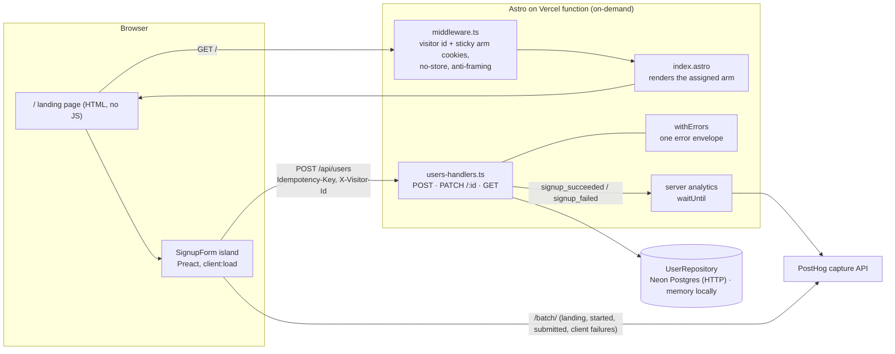

# Architecture

A conversion page (`/`) and a Users API in one Astro 7 app. The page is server-rendered per request so it can assign an A/B arm without flicker. The only client JavaScript is the signup form island (~23 KB gzip). Signups are confirmed and counted by the server. Draft by Claude from the ADRs and the code; owner to cut.

## 1. Application structure

| Path | Role |
|---|---|
| `src/contracts/users.ts` | The Users API contract as `zod/mini` schemas. Client and server import the same file. |
| `src/pages/api/users/*` → `src/server/users-handlers.ts` | Thin routes over handler factories that take their dependencies (`repo`, `analytics`) as arguments, so tests run without Astro. |
| `src/server/errors.ts` | The only `try/catch` around handlers; maps every failure to `{ error: { code, message, fields? } }`. |
| `src/server/*-repository.ts`, `db/schema.sql` | The persistence port, the Postgres and in-memory adapters, and the guard that picks one. |
| `src/middleware.ts`, `src/lib/experiment.ts` | Experiment assignment and cookies. |
| `src/components/signup/` | Pure state machine (`signup-machine.ts`), I/O (`signup-client.ts`), UI (`SignupForm.tsx`). |
| `src/analytics/` | Typed event registry, browser tracker, server emitter. |

## 2. Major decisions

| Decision | Why | ADR |
|---|---|---|
| Astro, one Preact island | Static HTML for a conversion page; Preact island 5.8 KB vs 69 KB for React (measured) | [001](decisions/ADR-001-astro-frontend.md), [006](decisions/ADR-006-island-stack-and-hydration.md) |
| Contract in `zod/mini`, shared by client and server | One validation source; classic `zod` would have shipped 95 KB to the browser (measured) | [006](decisions/ADR-006-island-stack-and-hydration.md) |
| Persistence behind `UserRepository`: Neon Postgres over HTTP, single-statement writes; memory for zero-setup local runs | Real unique/idempotency guarantees across serverless instances; no connection lifecycle to manage | [002](decisions/ADR-002-persistence.md) |
| Landing page rendered on demand | Astro middleware does not run for prerendered pages on Vercel, and assignment needs it | [004](decisions/ADR-004-experiment-assignment.md) |
| Cookieless analytics + one first-party visitor id; GPC = opt-out | No banner on the conversion page; legal assumption recorded | [007](decisions/ADR-007-consent-and-visitor-id.md) |
| PostHog via a thin typed HTTP client | `posthog-js` is 126 KB gzip; the whole layer added 1.6 KB | [003](decisions/ADR-003-analytics-client.md) |
| `client:load` for the form | Pre-registered rule applied to lab measurements; in practice a tie | [006](decisions/ADR-006-island-stack-and-hydration.md) |
| E2E on the Node adapter | `astro preview` does not support the Vercel adapter | [008](decisions/ADR-008-e2e-adapter.md) |

The conversion is emitted by the server after a first-time 201, never by the browser and never on an idempotent replay. That decision is recorded in ADR-003 and the analytics plan; ADR-005 was planned but never written.

## 3. Trade-offs (costs we pay)

- **Function in the critical path.** Every page view is a function invocation with no CDN-cached HTML. Lab LCP is 640–652 ms on a throttled mobile profile against a 2 s budget. That was measured on localhost: cold starts and real network were not measured.
- **The form is interactive at ~1.5 s** on the throttled profile (1473 ms median, `measure:hydration`); the button is visible but disabled for about 0.8 s after LCP. The chunk waterfall is two round trips deep. In the perf audit's run, which was caveated because it rewrote asset URLs, `modulepreload` traded +220 ms of LCP for −440 ms of hydration, so it was not adopted.
- **A database on the conversion path.** A first-time signup costs up to 3 HTTP round trips to Neon (key read, expired-key cleanup, one insert statement), and its latency was not measured. Preview deploys share the production database in this demo.
- **No auth.** `PATCH` and `GET /api/users` are open, and the list returns emails. They are marked `no-store`, but that does not make them private.
- **`email_taken` (409) reveals that an account exists.** This was accepted for signup UX. Email verification is the real fix.
- **Analytics undercounts its denominator.** Ad-blockers, GPC and visitors who leave before hydration are missing from it, so absolute rates are biased upward. Arm-vs-arm comparison is mostly unaffected because both arms share the bias.
- **Two client-writable cookies** (`fxr_vid`, `fxr_variant`). Editing them only pollutes attribution; nothing is authorized on them.

## 4. API and integration

- **Endpoints:** `POST /api/users` (201, `Location`), `PATCH /api/users/:id`, `GET /api/users?limit&cursor` (keyset cursor). The full table and edge cases are in [api-contract.md](api-contract.md).
- **Input checks run in this order:** content type (415), then size checked while streaming (413), then UTF-8 + JSON (400), then schema (422, all field errors at once).
- **Idempotency:**
  - The `Idempotency-Key` header is required.
  - The same key and body replays the *original* 201 body, even after a later PATCH.
  - The same key with a different body is a 422.
  - Two concurrent requests with the same email are verified to produce exactly one row, at the API level and against the live server.
- **CSRF:**
  - Astro's origin check covers form-style posts (403).
  - JSON is required (415), and no CORS preflight is ever approved.
  - Astro sends the CSP as a header with hashed sources and `frame-ancestors 'none'`.
- **Integration with the form:**
  - The island validates with the same schema, then POSTs.
  - The state machine decides the idempotency key: it is reused only for an exact retry after a network error, 5xx or 429.
  - The server reads the arm from the cookie, never from the request body.

## 5. Deployment architecture (planned, not deployed)

- **Hosting:** Vercel through `@astrojs/vercel`. The page and the API run as on-demand functions with Fluid compute; `/_astro/*` assets are static on the CDN.
- **Server analytics:** sent through `waitUntil`, so the 201 never waits for PostHog.
- **Configuration:** `astro:env` public variables (`PUBLIC_POSTHOG_KEY`, `PUBLIC_POSTHOG_HOST`, `PUBLIC_APP_ENV`, `PUBLIC_SIGNIN_URL`) plus one server secret, `DATABASE_URL`. The PostHog key and the sign-in URL are deliberately unset; see the README.
- **Database:** Neon Postgres (us-east-2), schema applied by `npm run db:migrate`. Without `DATABASE_URL`, prod and preview refuse to serve the API rather than fall back to memory.
- **Not done:**
  - The deployment itself.
  - CI: no `.github/workflows` exists yet.
  - Rate limiting.
  - A Vercel-side check of headers, cookies and CSP. E2E covers only the Node adapter (ADR-008).

## 6. Infrastructure considerations

- **Caching:** HTML is `private, no-store` (it carries a per-visitor arm and `Set-Cookie`), and so is every API response. Only hashed assets are cacheable.
- **Observability that exists:**
  - Error logs are redacted (error name plus a message with credentials and emails removed).
  - Analytics delivery failures are logged by error name only.
  - The data-quality checks in the analytics plan include a daily reconciliation of `signup_succeeded` against `users` rows, a sample-ratio mismatch check, and the CI tests.
- **Observability missing:** alerts, field RUM, and dashboards.
- **Reliability:** analytics can never change an HTTP response, and that is tested with a throwing emitter. An outage at PostHog costs events, not signups.
- **Security:**
  - Strict schemas reject unknown keys, including prototype-named ones.
  - Names reject bidi and invisible characters.
  - API responses carry `nosniff`.
  - `X-Frame-Options` covers older browsers.

## 7. What I would change for a production FX Replay system

1. **A Neon branch per PR and per preview deploy**, with the Neon race tests from `repository-contract.test.ts` running in CI against it. Today they are opt-in, and preview shares the production database.
2. **Edge rewrite to two prerendered variants** (Vercel Routing Middleware). This brings back CDN-served HTML; the risk is the cookie and assignment logic diverging between the two middlewares, so it should live in one shared function.
3. **Rate limiting at the edge** (Vercel WAF rules or Upstash). Without it, `POST /api/users` and the `signup_failed` counts are floodable.
4. **Transactional outbox** for `signup_succeeded`, so a crash between the commit and the emit cannot lose a conversion.
5. **First-party ingestion proxy** for PostHog (a rewrite under our domain), to recover ad-blocked events. Verify `$insert_id` and `sendBeacon` acceptance against a real project.
6. **Alert on a silent conversion drop.** Compare hourly `users` inserts with `signup_succeeded`, and conversion against a trailing baseline, through a Vercel log drain to an alerting tool.
7. **Auth and email verification.** Admin-only list, owner-only PATCH. Verification also removes the 409 enumeration leak.
8. **The Users API as its own service** once the product needs it, with the contract published as a package shared by the marketing site and the app.
9. **GitHub Actions running the existing commands:** `check`, Vitest, and Playwright against every Vercel preview URL. The suite already takes a `baseURL`.
